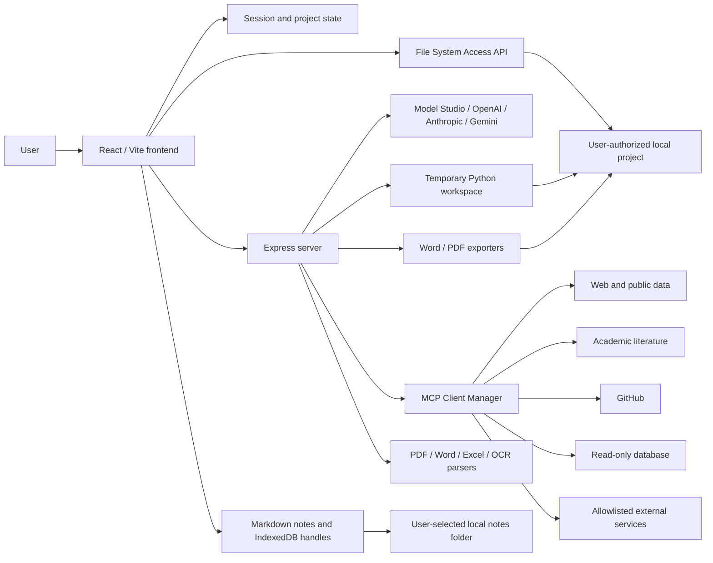
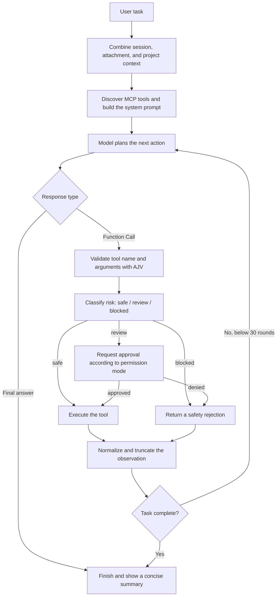
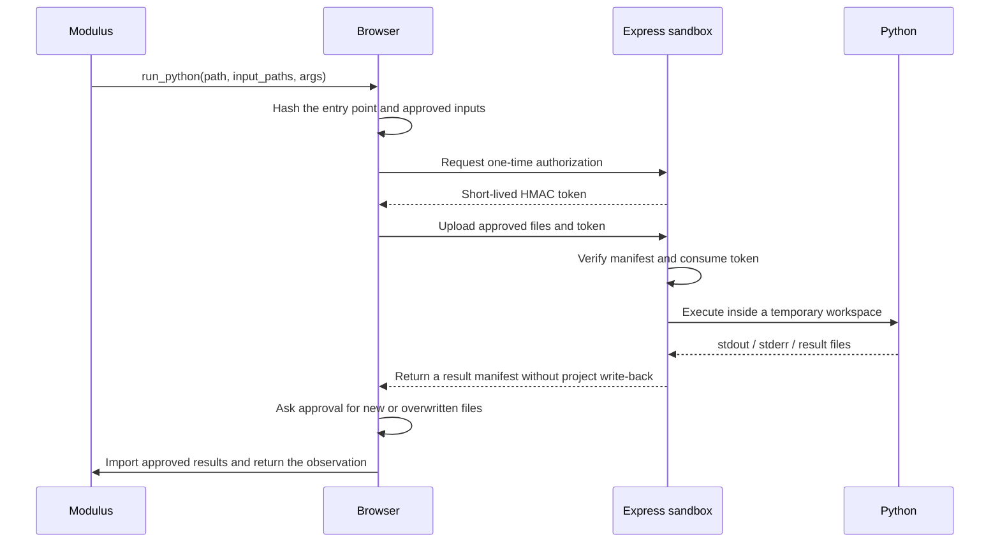
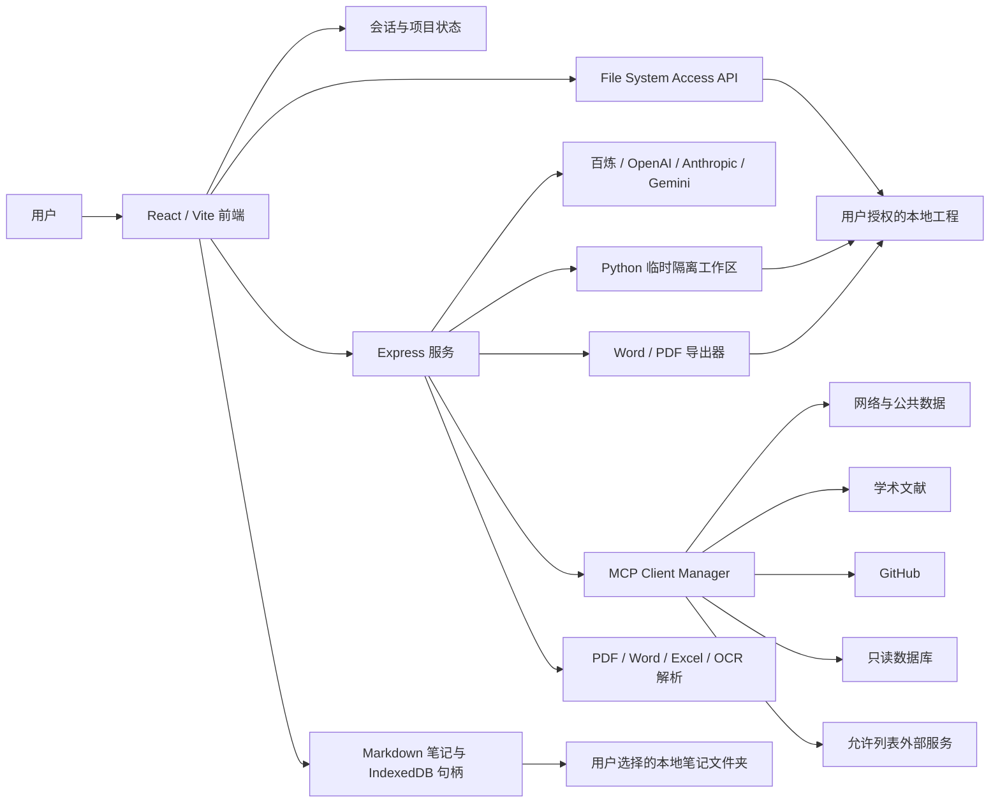
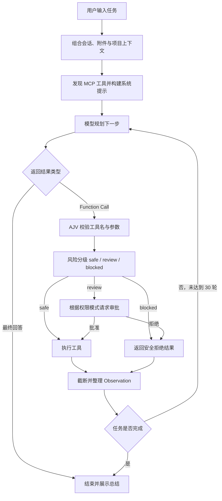
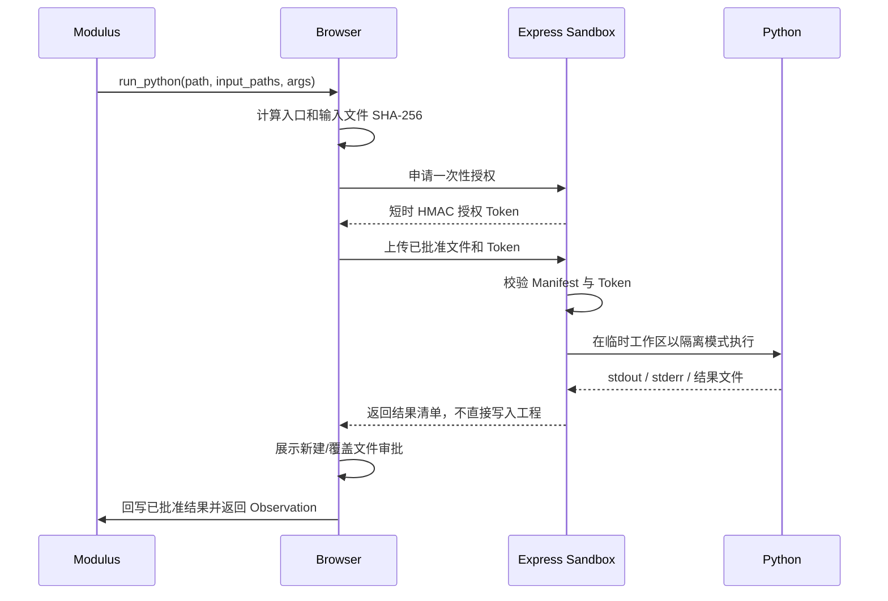

<div align="center">
  
  <h1>MathHub</h1>
  <p><strong>面向数学建模学习、竞赛备赛与工程实践的本地优先 AI 平台</strong></p>
  <p>Mathematical modeling knowledge, Markdown notes, competition resources, and an executable AI agent in one workspace.</p>

  <p>
    <a href="#本地运行"></a>
    <a href="#技术栈"></a>
    <a href="#数学建模-skills"></a>
    <a href="#modulus-智能体"></a>
    <a href="#数据持久化"></a>
    <a href="#中文"></a>
    <a href="#english"></a>
  </p>

  <p>
    <a href="#主要功能">主要功能</a> ·
    <a href="#本地运行">快速开始</a> ·
    <a href="#数模学习笔记">学习笔记</a> ·
    <a href="#modulus-智能体">Modulus 智能体</a> ·
    <a href="#数学建模-skills">Skills</a> ·
    <a href="#mcp-扩展">MCP 扩展</a> ·
    <a href="#english">English</a>
  </p>
</div>

---

> **MathHub** 将模型知识库、本地 Markdown 学习笔记、数模竞赛资源与可执行的 **Modulus 智能体** 放在同一个工作空间中，强调真实文件操作、可验证计算、受控工具调用和可直接交付的建模成果。

## 目录

- [1. 主要功能](#主要功能)
  - [1.1 数模学习笔记](#数模学习笔记)
  - [1.2 Modulus 智能体](#modulus-智能体)
- [2. 整体架构](#整体架构)
- [3. 数学建模 Skills](#数学建模-skills)
- [4. MCP 扩展](#mcp-扩展)
- [5. Python 隔离执行](#python-隔离执行)
- [6. Word 与 PDF 论文导出](#word-与-pdf-论文导出)
- [7. 项目结构](#项目结构)
- [8. 本地运行](#本地运行)
  - [8.1 环境要求](#环境要求)
  - [8.2 安装与启动](#1-安装依赖)
  - [8.3 使用 Modulus](#4-使用-modulus)
  - [8.4 使用数模学习笔记](#5-使用数模学习笔记)
- [9. 环境变量](#环境变量)
- [10. 数据持久化与当前边界](#数据持久化)
- [11. English documentation](#english)

---

## English

MathHub is an AI platform for mathematical modeling education, competition preparation, and project-based practice. It brings together a mathematical model library, Markdown learning notes, competition information, learning pathways, ability assessment, and the executable **Modulus mathematical modeling agent** in one web application.


Unlike a chat-only assistant, Modulus can work inside a user-authorized project directory: it can inspect source material, create and modify code, run Python, verify outputs, call external MCP services, and export models, charts, and conclusions as Word or PDF modeling papers.

> The current version is designed primarily for local use, personal study, modeling teams, and demonstrations. Accounts, sessions, and most model settings are stored in the browser; this is not yet a production-grade cloud multi-user system.

### Main Features

| Module | Current capabilities |
| --- | --- |
| Community home | Modeling-focused content, competition and learning entry points, and dynamic visual elements |
| Model library | Browse mathematical models by category and inspect principles, scenarios, limitations, cases, and Python/MATLAB examples |
| Modeling notes | Create, search, tag, pin, archive, import, export, and autosave Markdown notes; optionally synchronize them to a user-selected local folder |
| Competition center | Review major modeling competitions with local cover images, timelines, difficulty, requirements, and past-problem links |
| Learning pathways | Follow staged routes for beginners, advanced study, and competition training |
| Ability assessment | Generate radar charts and AI recommendations across abstraction, model selection, mathematics, algorithms, programming, and writing |
| Configuration center | Connect Alibaba Cloud Model Studio, OpenAI, and Anthropic text models, plus Model Studio vision, image, and video models |
| Modulus agent | Bind a project, read and search files, modify code, run Python, load Skills/MCP tools, and generate Word/PDF deliverables |

The left navigation supports a persistent compact mode. When collapsed, the MathHub brand and module icons remain visible while the current page expands into the released space; hovering an icon shows its module name.

### Technology Stack

#### Frontend

- React 19, TypeScript, and Vite
- Tailwind CSS 4, Motion, and Lucide React
- React Markdown, remark-gfm, KaTeX, remark-math, and rehype-katex
- Recharts
- File System Access API

#### Server

- Node.js, Express, tsx, and esbuild
- Multer, Mammoth, Word Extractor, PDF.js, Tesseract.js, Sharp, and XLSX
- JSZip, KaTeX, and Puppeteer
- MCP TypeScript SDK, AJV, and PostgreSQL Client

#### Model Providers

- Alibaba Cloud Model Studio through its OpenAI-compatible API
- OpenAI Chat Completions
- Anthropic Messages API
- Google Gemini for environment-configured defaults and compatibility fallback

### System Architecture



The application is not simply a frontend chat connected to an API proxy:

- The browser owns the user-selected `FileSystemDirectoryHandle`; every tool path is normalized to a project-relative path.
- The frontend manages sessions, project trees, risk classification, approvals, and project write-back.
- The server handles model gateways, native Function Calling, MCP connections, restricted Python execution, file parsing, and document generation.
- The model decides which tool should run next, but it never receives direct operating-system file permissions.

### Modeling Learning Notes

The **Modeling Notes** module is a browser-based Markdown knowledge workspace intended for formulas, model summaries, code experiments, task lists, and post-competition reviews.

- Create notes in a user-selected local folder as real `.md` files, or keep browser-only notes until a folder is selected.
- Use edit, split, or preview mode. The preview renders GFM tables and task lists, fenced code blocks, links, headings, and KaTeX inline/display formulas.
- Search titles, bodies, and tags; filter by folder, pinned status, or archive status.
- Pin, archive, restore, delete, import, and export notes from the editor toolbar.
- Importing an existing Markdown file creates a browser note; use export or create a new file-backed note when a synchronized copy is required in the selected folder.
- Changes are autosaved to the current account's browser storage. Notes backed by a local file are also written to the authorized folder after editing.
- Renaming a file-backed note title renames its `.md` file. Filename-invalid characters are sanitized, and a numeric suffix is added when needed to avoid overwriting another file.
- The selected notes directory handle is stored per local account in browser IndexedDB. Browsers may still require the user to renew read/write permission after a restart or permission change.

The notes feature requires the File System Access API for direct folder synchronization. Import, export, browser-only editing, and Markdown preview remain separate from the Modulus project workspace; selecting a notes folder does not grant the agent access to that folder.

### The Modulus Agent


#### Design Goal

Modulus is designed to complete a verifiable mathematical modeling workflow:

1. Understand the problem statement and project context.

2. Select the appropriate modeling Skill.

3. Inspect data, papers, code, and existing results.

4. Create a reproducible Python program.

5. Execute that program in a restricted workspace.

6. Observe errors and outputs, then revise when necessary.

7. Produce charts, datasets, Word documents, and PDF papers.

8. Return a concise summary only after the tool work is complete.

#### Agent Loop

A single task may use up to **30 model–tool rounds**. The orchestration loop lives in `src/App.tsx`; tool definitions, validation, and provider-specific Function Calling live in `agent-runtime.ts`.



Each round follows this general process:

1. Build the active context from system constraints, message history, the selected project, attachments, the Skills catalog, and available MCP tools.
2. Prefer `/api/agent/turn-stream` for streamed assistant text and structured tool calls.
3. Convert built-in tools and discovered MCP tools into native functions with JSON Schema definitions.
4. Validate every tool call with AJV; invalid calls are never executed.
5. Classify the requested operation by path, mutation type, sensitive-data exposure, and external-service risk.
6. Execute approved calls and append their results to the conversation as observations.
7. Let the model decide whether to read more, repair code, rerun Python, export files, or finish.
8. If the user explicitly requests Word/PDF but the model only announces an export, perform a controlled recovery turn that requires the missing export tool.

#### Native Function Calling and Compatibility Mode

Modulus prefers native Function Calling:

- Model Studio and OpenAI use the OpenAI-compatible tools format.
- Claude uses Anthropic `tool_use` blocks.
- Gemini uses `functionDeclarations`.
- MCP tools are converted into model-visible functions while retaining their real Server/Tool mapping.

Only when a model endpoint explicitly lacks native tool support does the frontend fall back to the legacy `<ToolCall>{...}</ToolCall>` text protocol. Authentication, quota, balance, and rate-limit errors remain visible and are never hidden by fallback behavior.

For Model Studio models that enable reasoning by default but require non-thinking mode for tool calling, the runtime adjusts the request automatically. This prevents a model from passing a connectivity test but failing during Function Calling.

#### Projects, Sessions, and Message Editing

- A user may select a project folder first; MathHub then creates and binds a session named after that project.
- A user may also start chatting without selecting a project, which creates a regular session.
- Each session keeps independent messages, project metadata, a project tree, and update timestamps.
- Serializable session data is stored in `localStorage`; directory handles remain browser-session state and are not serialized.
- Every user and assistant message supports copying and editing.
- Sending an edited historical message creates a new branch from that point so outdated answers do not pollute the new context.
- The input area grows and wraps automatically: `Enter` sends, while `Shift + Enter` inserts a new line.

#### Built-in Tools

| Tool | Purpose | Main restriction |
| --- | --- | --- |
| `load_skill` | Load a specialized modeling or scientific-research workflow | Select only the 1–3 most relevant Skills for a task |
| `load_skill_resource` | List or read a Nature Skill manifest, reference, template, or script guide | Text resources are loaded on demand and long files are paged |
| `list_files` | Inspect the project tree | Returned nodes are bounded |
| `read_file` | Read text, code, PDF, Word, and spreadsheet content | Project-relative paths only; sensitive files require review |
| `search_files` | Search filenames and readable content | Sensitive files are skipped and scan size is bounded |
| `create_directory` | Create a project directory | Requires project write permission |
| `write_text_file` | Write code, text, or data | At most one million characters per call |
| `replace_in_file` | Precisely replace existing text | Unique match by default; existing-file edits are reviewed |
| `run_python` | Run a project Python entry point | Temporary workspace, one-time authorization, no network or subprocesses |
| `create_word_document` | Generate general Word files or modeling papers | Supports formulas, tables, TOC, page breaks, and project images |
| `create_pdf_document` | Generate a fully formatted PDF paper | Shares the paper content and result images used for Word |
| `mcp_call` | Invoke a connected MCP tool | Schema validation, allowlists, timeouts, and output limits |

Tool observations are capped at 24,000 characters so large logs, tracebacks, and webpages do not consume the entire conversation context. The UI shows compact step summaries rather than dumping complete tool payloads by default.

### Mathematical Modeling Skills

Skills live under `src/skills/`. They are registered through YAML Frontmatter and loaded at build time by `src/skills/index.ts`. For a professional task, Modulus first loads the most relevant Skill and then follows its workflow and quality gates.

The project currently includes 12 modeling Skills plus 18 triggerable Nature research Skills. Nature resources remain in their original directories and are loaded progressively; `nature-shared` is an internal dependency rather than a standalone Skill.

| Skill | Purpose |
| --- | --- |
| `frame-contest-problem` | Understand and decompose a contest problem |
| `audit-modeling-data` | Audit data provenance, quality, missingness, and credibility |
| `explore-modeling-data` | Perform exploratory data analysis and feature discovery |
| `design-mathematical-model` | Define variables, assumptions, constraints, and model structure |
| `solve-optimization-model` | Formulate and solve optimization problems |
| `forecast-time-series` | Build, validate, and backtest time-series forecasts |
| `simulate-uncertainty` | Run Monte Carlo and uncertainty analysis |
| `validate-model-robustness` | Perform sensitivity, robustness, and error analysis |
| `visualize-model-results` | Produce paper-ready result visualizations |
| `write-himcm-paper` | Generate an English HiMCM Word/PDF paper |
| `write-mcm-paper` | Generate an English MCM paper on US Letter with 2.54 cm margins |
| `write-chinese-modeling-paper` | Generate a Chinese paper using the MCM page rules, SimSun for Chinese, and Times New Roman for Latin characters and numbers |

The paper-writing Skills control the abstract, contents, section structure, assumptions, captions, equation explanations, references, model evaluation, conclusion, and code appendix. The exporters embed actual result images from the project instead of leaving image paths in the paper.

The Nature suite adds academic search, citation handling, data analysis, experiment logging, figure design, literature pipelines, paper reading/writing/review, reference verification, statistics, reviewer responses, proposal writing, paper-to-slides, and paper-to-patent workflows. Features that require upstream browser automation, terminal services, R, credentials, or optional document libraries run only when an equivalent MathHub tool is available; Modulus reports those limits instead of claiming the operation ran.

### MCP Extensions

MCP servers are configured in the root `mcp.config.json` and may use local `stdio` or Streamable HTTP transports.

Five local MCP servers are enabled by default:

| Server | Main capabilities |
| --- | --- |
| `web-data` | Web search, page extraction, and public JSON retrieval |
| `academic-research` | OpenAlex, Crossref, and DOI metadata |
| `github` | Repository search, metadata, file reading, and Issue/PR search |
| `database` | Database status, schema inspection, and read-only SQL |
| `external-services` | Owner-configured, allowlisted HTTP services |

MCP safety controls include:

- Per-server `allowedTools` lists.
- JSON Schema validation for model-generated arguments.
- Result truncation and mandatory treatment of all MCP output as untrusted data.
- Blocking of localhost, private, link-local, and reserved network targets by bundled web tools.
- PostgreSQL queries executed inside `READ ONLY` transactions.
- External stdio commands, non-local HTTP MCP servers, and remote MCP execution disabled by default.
- Detection and blocking of likely keys, tokens, credentials, and private keys before MCP calls.

### Restricted Python Execution

When a modeling task requires computation, fitting, optimization, simulation, or plotting, Modulus must first write a reproducible script into the project and then call `run_python`.



Current limits include:

- Up to 80 input files and 60 MB per execution.
- A configurable timeout between 5 and 120 seconds.
- A maximum temporary workspace size of 256 MB and 2,000 files.
- Up to 12 MB per returned file and 24 MB total returned results.
- Bounded standard output and error output.
- Network, subprocesses, system commands, and access outside the workspace are blocked by default.
- Authorization is bound to the entry point, input hashes, arguments, and timeout; it is short-lived and single-use.
- Generated files require a second approval before project write-back; rejected files disappear with the temporary workspace.

> This is application-level isolation and auditing, not a replacement for an operating-system container or virtual machine. A service exposed to untrusted remote users should run Python inside a hardened, disposable container or VM.

### Approval Modes

The permission selector below the Modulus input supports three modes:

| Mode | Behavior |
| --- | --- |
| Ask for approval | Ask before code execution, existing-file changes, or external service access |
| Agent approval | Automatically allow isolated execution and new outputs; ask only for detected risk operations |
| Full access | Automatically approve operations inside the current project while preserving system safety boundaries |

No mode disables project path boundaries, sensitive-file protection, secret exfiltration checks, Python isolation, or MCP allowlists.

### Word and PDF Export

Modulus can send the same Markdown paper content to both exporters:

- Inline `$...$` and display `$$...$$` mathematics.
- Editable OMML formulas in Word.
- Markdown tables, continuous captions, and centered cells.
- Embedded project PNG, JPEG, WebP, and SVG figures.
- `[TOC]` and `[PAGEBREAK]` controls.
- HiMCM, MCM, and Chinese modeling-paper formats.
- Shared titles, body text, formulas, tables, and image sources between Word and PDF.

### Project Structure

```text
MathHub/
├── src/
│   ├── App.tsx                     # UI, sessions, Agent loop, tool execution, and approvals
│   ├── components/
│   │   ├── ModelingNotes.tsx       # Markdown notes, local-folder sync, search, and preview
│   │   └── CompetitionCover.tsx    # Competition cover rendering
│   ├── data.ts                     # Model library, competitions, pathways, and assessment data
│   ├── types.ts                    # Frontend data types
│   ├── main.tsx                    # React entry point
│   ├── index.css                   # Global styles
│   ├── assets/images/competitions/ # Local competition cover images and source notes
│   ├── assets/                     # Other frontend assets
│   └── skills/                     # Modeling and Nature Skills plus paper-format references
├── mcp-servers/                    # Five bundled MCP servers
├── test/                           # Modeling and paper-generation fixtures
├── agent-runtime.ts                # Tool registry, validation, and provider Function Calling
├── mcp-client.ts                   # MCP configuration, discovery, connection, and calls
├── python-approval.ts              # One-time Python authorization
├── word-document.ts                # Word OOXML/OMML generation
├── pdf-document.ts                 # PDF/HTML/KaTeX generation
├── server.ts                       # Express APIs, model gateway, parsers, sandbox, and exporters
├── mcp.config.json                 # MCP servers and allowed tools
├── package.json
├── vite.config.ts
├── tsconfig.json
├── .env.example
└── README.md
```

### Local Development

#### Requirements

- Node.js 22 or later
- npm 10 or later
- Optional: Python 3.10+ for Modulus code execution
- Recommended: a recent Chrome or Edge version for the File System Access API

#### Install dependencies

```bash
npm install
```

#### Create `.env`

Windows PowerShell:

```powershell
Copy-Item .env.example .env
```

macOS / Linux:

```bash
cp .env.example .env
```

Minimum example:

```env
GEMINI_API_KEY="YOUR_GEMINI_API_KEY"
APP_URL="http://localhost:3000"
PYTHON_EXECUTABLE="python"
```

Model Studio, OpenAI, and Anthropic text credentials can be saved per local account in the Configuration Center. Vision, image, and video settings are configured separately in the same UI.

#### Start the application

```bash
npm run dev
```

Open `http://localhost:3000`. In development, `server.ts` starts Express and mounts Vite as middleware.

#### Use Modulus

1. Open the **Modulus Agent** section.
2. Optionally select a project folder with the plus button; you may also start a project-free conversation.
3. Grant browser read/write permission for the selected project.
4. Choose an approval mode.
5. Enter a task such as: “Read the contest PDF, build and execute a model, generate result charts, and export an MCM Word and PDF paper.”

#### Use Modeling Notes

1. Open **Modeling Notes** from the left navigation.
2. Select a local notes folder if the notes should be stored as real `.md` files. This step can be changed later.
3. Create a note or import an existing Markdown file.
4. Use the pencil, split-view, and eye buttons to switch between source editing, source plus live preview, and full preview.
5. Edit the title, folder classification, and comma-separated tags. File-backed notes are autosaved and renamed with the title.

Use a recent Chromium-based browser and grant read/write permission when prompted. Keep a backup or version-control history for important notes. Deleting a note currently removes its MathHub record but deliberately leaves any corresponding local `.md` file in place.

### Environment Variables

| Variable | Purpose |
| --- | --- |
| `GEMINI_API_KEY` | Default Gemini chat and part of the file-understanding flow |
| `APP_URL` | Application URL |
| `PYTHON_EXECUTABLE` | Python executable path or command |
| `ALLOW_REMOTE_PYTHON_EXECUTION` | Permit non-local requests to trigger Python; default `false` |
| `ALLOW_EXTERNAL_MCP_STDIO` | Permit non-bundled MCP stdio commands |
| `ALLOW_REMOTE_MCP_HTTP` | Permit non-local MCP HTTP endpoints |
| `ALLOW_REMOTE_MCP_EXECUTION` | Permit non-local browser clients to invoke MCP |
| `BRAVE_SEARCH_API_KEY` | Full web search; without it, limited public fallbacks are used |
| `OPENALEX_API_KEY` | OpenAlex academic search |
| `OPENALEX_EMAIL` | OpenAlex client contact |
| `CROSSREF_MAILTO` | Crossref client contact |
| `GITHUB_TOKEN` | Higher GitHub API limits or token-visible repository access |
| `DATABASE_URL` | PostgreSQL connection string |
| `DATABASE_SSL` | PostgreSQL SSL switch |
| `MCP_EXTERNAL_SERVICES_JSON` | External-service allowlist and credential environment mappings |

Never commit a real `.env`, API key, database password, or access token.

### Scripts

```bash
npm run dev      # Start Express + Vite development mode
npm run build    # Build the frontend and bundle dist/server.cjs
npm start        # Start the production build
npm run preview  # Preview Vite frontend output
npm run lint     # Run TypeScript checks
npm run test:agent-runtime # Run Agent runtime tests
npm run clean    # Remove build artifacts
```

### Main APIs

Model and multimodal APIs:

- `POST /api/test-text-model`
- `POST /api/test-bailian`
- `POST /api/test-vision`
- `POST /api/test-imagegen`
- `POST /api/test-videogen`
- `POST /api/chat`
- `POST /api/upload`
- `POST /api/image-generation`
- `POST /api/video-generation`

Modulus APIs:

- `POST /api/agent/turn`
- `POST /api/agent/turn-stream`
- `GET /api/agent/mcp/tools`
- `POST /api/agent/mcp/call`
- `POST /api/agent/python-approval`
- `POST /api/agent/run-python`
- `POST /api/agent/create-docx`
- `POST /api/agent/create-pdf`

### Persistence and Current Boundaries

Local account state, profile data, model configuration, Modulus messages, the active session ID, modeling-note metadata/content, sidebar preference, and assessment state are primarily stored in browser `localStorage`. The active module is kept in `sessionStorage` so a development reload can return to the same page.

The authorized Modulus project directory handle is browser-session state and is not stored in a server database. The Modeling Notes directory handle is stored per local account in IndexedDB, but the browser may still require renewed permission after a restart, refresh, or permission change. Neither type of directory handle is uploaded to MathHub's server database.

Current limitations:

- The local account UI is not server-side authentication and should not be used directly for production multi-tenancy.
- API keys are stored in local browser configuration; take care on shared devices.
- File System Access API support is browser-dependent; Chromium-based browsers are recommended.
- Local Markdown synchronization depends on the user retaining folder permission; browser storage should not be treated as the only backup for important notes.
- Remote Python execution requires additional containerization, resource quotas, and host isolation.
- The Word/PDF exporters target the bundled competition formats; arbitrary complex Word templates may need dedicated adapters.
- External MCP, database, and web data must always be treated as untrusted input.

### Suitable Use Cases

- Mathematical modeling competition training and paper production
- University modeling-team or course platforms
- Personal modeling knowledge bases, formula notes, code experiments, and competition reviews
- Joint analysis of contest PDFs, datasets, and code projects
- Reproducible computation, plotting, robustness validation, and reporting
- Teaching demonstrations for AI Agents, Skills, MCP, and controlled code execution
  
### Acknowledgements and Third-Party Skills

MathHub integrates and adapts scientific-research Skill resources from Yuan1z0825's open-source project [`nature-skills`](https://github.com/Yuan1z0825/nature-skills), which provides reusable workflows for academic search, paper reading and writing, citation checking, data analysis, scientific figures, peer review, and related research tasks. The upstream project is distributed under the [Apache License 2.0](https://github.com/Yuan1z0825/nature-skills/blob/main/LICENSE). Copyright, contributor attribution, and license notices for the incorporated resources remain with their respective upstream authors and contributors. MathHub is an independent integration and is not an official release of, or endorsement by, the `nature-skills` project. Please consult the upstream repository for its latest documentation, license terms, dependencies, and updates.

---

## 中文

MathHub 是一个面向数学建模学习、竞赛备赛和工程实践的 AI 平台。项目将数学模型知识库、Markdown 学习笔记、竞赛信息、学习路径、能力测评与可执行的 **Modulus 数学建模智能体** 集成在同一个 Web 应用中。


与只负责回答问题的聊天机器人不同，Modulus 可以在用户授权的工程目录内读取资料、编写和修改代码、运行 Python、检查结果、调用 MCP 外部服务，并把模型、图表和结论导出为 Word 或 PDF 数模论文。

> 当前版本主要面向本地运行、个人学习、竞赛团队协作和功能演示。账户、会话与大部分模型配置保存在浏览器本地，不是完整的云端多用户系统。

## 主要功能

| 模块 | 当前能力 |
| --- | --- |
| 社区首页 | 数模主题内容展示、竞赛与学习入口、动态视觉元素 |
| 模型库 | 按类别浏览数学模型，查看原理、场景、限制、案例及 Python/MATLAB 示例 |
| 数模学习笔记 | 新建、搜索、标签、置顶、归档、导入、导出和自动保存 Markdown 笔记，并可同步到用户选择的本地文件夹 |
| 竞赛中心 | 通过本地封面图片展示常见数学建模竞赛、时间线、难度、参赛要求与历年题入口 |
| 学习路径 | 为新手、进阶学习和竞赛训练提供阶段化路线 |
| 能力测评 | 从问题抽象、模型选择、数学基础、算法、编程和论文表达等维度生成雷达图与 AI 建议 |
| 配置中心 | 接入阿里云百炼、OpenAI、Anthropic 文本模型，以及百炼视觉、生图和视频模型 |
| Modulus 智能体 | 绑定工程、读取文件、检索内容、修改代码、执行 Python、调用 Skills/MCP、生成 Word/PDF |

左侧导航栏支持记忆折叠状态。收起后仍保留 MathHub 品牌和各模块图标，鼠标悬停可查看栏目名称，主内容区会自动占用释放出来的空间。

## 技术栈

### 前端

- React 19、TypeScript、Vite
- Tailwind CSS 4、Motion、Lucide React
- React Markdown、remark-gfm、KaTeX、remark-math、rehype-katex
- Recharts
- File System Access API

### 服务端

- Node.js、Express、tsx、esbuild
- Multer、Mammoth、Word Extractor、PDF.js、Tesseract.js、Sharp、XLSX
- JSZip、KaTeX、Puppeteer
- MCP TypeScript SDK、AJV、PostgreSQL Client

### 模型接入

- 阿里云百炼 OpenAI 兼容接口
- OpenAI Chat Completions
- Anthropic Messages API
- Google Gemini（环境变量默认能力与兼容回退）

## 整体架构



前后端职责并非简单地“前端聊天、后端转发”：

- 浏览器持有用户主动选择的 `FileSystemDirectoryHandle`，所有工程路径都必须归一化为工程内相对路径。
- 前端负责会话状态、项目树、工具风险判断、用户审批和工程文件回写。
- 服务端负责模型网关、原生 Function Calling、MCP 连接、受限 Python 执行、文件解析及 Word/PDF 生成。
- 模型只负责决策“下一步调用什么工具”，不会直接获得操作系统文件权限。

## 数模学习笔记

“数模学习笔记”是面向公式整理、模型总结、代码实验、任务清单和赛后复盘的浏览器 Markdown 知识工作台。

- 可在用户选择的本地文件夹内创建真实 `.md` 文件；未选择文件夹时也可以先使用仅保存在浏览器中的笔记。
- 支持编辑、分栏和预览三种模式。实时预览可渲染 GFM 表格与任务清单、代码块、链接、标题，以及 KaTeX 行内/独立公式。
- 可搜索标题、正文和标签，并按文件夹、置顶状态或归档状态筛选。
- 支持置顶、归档、恢复、删除、导入和导出，相关操作集中在编辑器工具栏。
- 导入已有 Markdown 文件时会先创建浏览器笔记；如果需要在所选文件夹中生成同步副本，可导出该笔记，或新建一篇绑定本地文件的笔记。
- 修改内容后会自动保存到当前账号的浏览器存储；已绑定本地文件的笔记还会写入已授权文件夹。
- 修改已绑定笔记的标题会同步重命名 `.md` 文件；系统会清理文件名中的非法字符，并在重名时添加数字后缀，避免覆盖已有文件。
- 本地笔记文件夹句柄按账号存放在浏览器 IndexedDB 中；浏览器重启、权限变化后仍可能要求重新授予读写权限。

直接同步本地文件夹依赖 File System Access API。笔记的导入、导出、浏览器内编辑和 Markdown 预览与 Modulus 工程空间相互独立；选择笔记文件夹不会自动授予智能体访问该目录的权限。

## Modulus 智能体


### 设计目标

Modulus 的目标是完成一个可验证的数学建模工作闭环：

1. 理解赛题和工程上下文。

2. 选择合适的建模 Skill。

3. 读取数据、论文、代码和现有结果。

4. 生成可复现的 Python 脚本。

5. 在隔离环境中真实执行脚本。

6. 根据输出、报错和结果文件继续修正。

7. 生成图表、数据文件、Word 或 PDF 成果。

8. 在全部工具工作完成后给出简洁总结。

### Agent 执行循环

单次任务最多进行 **30 轮**模型—工具交互。核心循环位于 `src/App.tsx`，模型工具定义与结构化调用位于 `agent-runtime.ts`。



每轮大致执行以下逻辑：

1. 将系统约束、历史消息、已选择工程、附件内容、Skills 目录和 MCP 工具目录组合为当前上下文。
2. 优先调用 `/api/agent/turn-stream`，以流式方式获取模型正文和结构化工具调用。
3. 将内置工具和已发现的 MCP 工具转换为带 JSON Schema 的原生函数定义。
4. 使用 AJV 校验工具参数；无法通过校验的调用不会执行。
5. 根据路径、操作类型和外部服务类型进行风险分级。
6. 执行经过允许的工具，把结果作为 Observation 放回消息链。
7. 模型根据新结果决定继续读取、修正、运行、导出或结束。
8. 若用户明确要求 Word/PDF，而模型只口头宣布导出，系统会进行受控恢复并强制请求缺失的导出工具。

### 原生 Function Calling 与兼容模式

Modulus 优先使用模型原生 Function Calling：

- 百炼与 OpenAI 使用 OpenAI 兼容工具格式。
- Claude 使用 Anthropic `tool_use` 格式。
- Gemini 使用 `functionDeclarations`。
- MCP 工具在运行时转换为模型可见的函数，并保留真实的 Server/Tool 映射。

如果某个模型接口明确不支持原生工具调用，前端才会回退到旧的 `<ToolCall>{...}</ToolCall>` 文本协议。认证、余额、额度和限流错误不会被兼容回退掩盖。

对于默认开启思考模式、但工具调用需要非思考模式的百炼模型，运行时会自动调整参数，避免出现连通测试成功但 Function Calling 失败的问题。

### 工程与会话模型

- 用户可以先选择项目目录，系统会自动创建并绑定一个以项目名称命名的会话。
- 用户也可以不选项目，直接发送消息创建普通会话。
- 每个会话保存独立的消息、项目名称、项目树和更新时间。
- 会话内容存入 `localStorage`；目录句柄只保留在当前浏览器会话中，不会被序列化。
- 用户和智能体的每条消息均支持复制与编辑。
- 编辑历史消息并发送时，会从该消息位置建立新的对话分支，避免旧回答污染新上下文。
- 输入框支持自动换行和动态增高：`Enter` 发送，`Shift + Enter` 换行。

### 内置工具

| 工具 | 用途 | 关键限制 |
| --- | --- | --- |
| `load_skill` | 加载数学建模或科研专业工作流 | 一次任务只选择最相关的 1–3 个 Skills |
| `load_skill_resource` | 列出或读取 Nature Skill 的清单、参考资料、模板或脚本说明 | 按需加载文本资源，长文件可分页读取 |
| `list_files` | 查看工程目录结构 | 最多返回有限数量节点 |
| `read_file` | 读取文本、代码、PDF、Word、Excel 等 | 仅允许工程内路径；敏感文件需要审批 |
| `search_files` | 搜索文件名与可读文本 | 跳过敏感文件并限制扫描规模 |
| `create_directory` | 创建工程目录 | 需要工程写权限 |
| `write_text_file` | 写入代码、文本和数据文件 | 单次内容不超过 100 万字符 |
| `replace_in_file` | 精确替换已有文件内容 | 默认只允许唯一匹配；修改已有文件属于风险操作 |
| `run_python` | 执行工程内 Python 脚本 | 临时工作区、一次性授权、禁止网络和子进程 |
| `create_word_document` | 生成普通 Word 或数模论文 | 支持公式、表格、目录、分页和结果图 |
| `create_pdf_document` | 生成排版完成的 PDF 论文 | 与 Word 共用论文内容和结果图 |
| `mcp_call` | 调用已连接 MCP 工具 | Schema 校验、允许列表、超时和结果长度限制 |

工具输出最多保留 24,000 字符，防止日志、Traceback 或外部网页内容挤占完整对话上下文。界面默认只显示步骤概览，不直接展开大段工具输入输出。

## 数学建模 Skills

Skills 位于 `src/skills/`，通过 YAML Frontmatter 注册，由 `src/skills/index.ts` 在构建时加载。专业任务开始时，Modulus 先加载最相关的 Skill，再按照其中的步骤、质量标准和交付规则执行。

当前内置 12 个数学建模 Skills，并接入了 18 个可触发的 Nature 科研 Skills。Nature 的附属资源保持原目录结构并按需读取；`nature-shared` 仅作为内部依赖，不会作为独立 Skill 触发。

| Skill | 作用 |
| --- | --- |
| `frame-contest-problem` | 赛题理解、任务拆解与目标定义 |
| `audit-modeling-data` | 数据来源、质量、缺失值与可信度审计 |
| `explore-modeling-data` | 探索性数据分析与特征识别 |
| `design-mathematical-model` | 变量、假设、约束与模型结构设计 |
| `solve-optimization-model` | 优化问题建模、求解与结果解释 |
| `forecast-time-series` | 时间序列建模、预测与回测 |
| `simulate-uncertainty` | 蒙特卡洛模拟和不确定性分析 |
| `validate-model-robustness` | 敏感性、稳健性和误差分析 |
| `visualize-model-results` | 生成适合论文的结果图表 |
| `write-himcm-paper` | 按 HiMCM 专用格式生成英文 Word/PDF 论文 |
| `write-mcm-paper` | 按 MCM Letter 纸张及 2.54 cm 页边距生成英文论文 |
| `write-chinese-modeling-paper` | 沿用 MCM 页面规范生成中文论文，中文宋体、数字与字母 Times New Roman |

论文 Skills 会约束摘要、目录、正文结构、假设、表图题注、公式解释、参考文献、模型评价、结论和代码附录。Word 与 PDF 导出器会真实嵌入工程中的结果图片，而不是只输出图片路径。

Nature 套件补充了学术检索、引文处理、科研数据、实验日志、论文图表、文献流水线、论文阅读/写作/评审、参考文献核验、统计分析、审稿回复、研究计划、论文转演示和论文转专利等工作流。依赖上游浏览器自动化、终端服务、R、账号凭据或可选文档库的环节，只会在 MathHub 存在等价工具时执行；否则 Modulus 会明确说明能力边界。

## MCP 扩展

MCP Server 在根目录 `mcp.config.json` 中配置，支持本地 `stdio` 和 Streamable HTTP 两种传输方式。

项目默认启用 5 个本地 MCP Server：

| Server | 主要工具 |
| --- | --- |
| `web-data` | 网络搜索、网页正文读取、公共 JSON 获取 |
| `academic-research` | OpenAlex、Crossref、DOI 元数据 |
| `github` | 仓库搜索、仓库信息、文件读取、Issue/PR 搜索 |
| `database` | 数据库状态、表结构、只读 SQL 查询 |
| `external-services` | 项目所有者显式配置的允许列表 HTTP 服务 |

MCP 安全策略包括：

- `allowedTools` 限制每个 Server 可暴露的工具。
- 参数按 MCP 提供的 JSON Schema 校验。
- 返回内容按长度截断，并始终按“不可信外部数据”处理。
- 内置网络工具阻止本机、内网、链路本地及保留地址访问。
- 数据库查询在 PostgreSQL `READ ONLY` 事务中运行。
- 非本机 HTTP MCP、外部 stdio 命令和远程浏览器执行默认关闭。
- 疑似密钥、令牌或私钥不会被发送给 MCP。

## Python 隔离执行

建模任务需要计算、拟合、优化、仿真或绘图时，Modulus 必须先把可复现脚本写入工程，再调用 `run_python` 执行。

执行流程：



当前主要限制：

- 一次最多 80 个输入文件，总计不超过 60 MB。
- Python 超时可设置为 5–120 秒。
- 临时工作区最多 256 MB、2,000 个文件。
- 单个回传文件不超过 12 MB，回传结果总计不超过 24 MB。
- 标准输出与错误输出总量受限。
- 默认禁止网络访问、子进程、系统命令和工程外文件访问。
- 授权与入口脚本、输入文件哈希、参数和超时绑定，短时有效且只能使用一次。
- Python 结果需要第二次审批后才会写回用户工程；未批准结果随临时工作区清理。

> 该机制是应用层隔离与审计，不等同于容器、虚拟机或操作系统级安全沙箱。若开放给远程不可信用户，应在独立、可销毁的容器或虚拟机中运行服务。

## 操作审批

输入框下方可选择三种权限模式：

| 模式 | 行为 |
| --- | --- |
| 请求批准 | 执行代码、修改已有文件或访问外部服务前询问 |
| 替我审批 | 自动允许隔离执行和新建结果，只对检测到的高风险操作询问 |
| 完全访问权限 | 自动批准当前工程内操作，但系统级安全边界仍然有效 |

无论选择哪种模式，下列保护都不会被关闭：

- 工程目录边界与 `..` 路径跳转检查。
- 敏感文件识别与密钥泄露拦截。
- Python 网络、子进程和工程外访问限制。
- MCP 工具允许列表与外部服务限制。

## Word 与 PDF 论文导出

Modulus 可以把相同 Markdown 论文内容分别交给 Word 和 PDF 导出器：

- 行内公式 `$...$` 与独立公式 `$$...$$`。
- Word 中生成可编辑 OMML 公式。
- Markdown 表格、连续表题和单元格居中。
- 工程内 PNG、JPEG、WebP、SVG 结果图嵌入。
- `[TOC]` 目录与 `[PAGEBREAK]` 分页控制。
- HiMCM、MCM 和中文数模论文格式。
- Word/PDF 共用标题、正文、公式、表格和图片来源，减少两个版本的内容偏差。

## 项目结构

```text
MathHub/
├── src/
│   ├── App.tsx                     # 主界面、会话状态、Agent 循环、工具执行与审批
│   ├── components/
│   │   ├── ModelingNotes.tsx       # Markdown 笔记、本地文件夹同步、搜索和预览
│   │   └── CompetitionCover.tsx    # 竞赛封面展示
│   ├── data.ts                     # 模型库、竞赛、学习路径和测评数据
│   ├── types.ts                    # 前端数据类型
│   ├── main.tsx                    # React 入口
│   ├── index.css                   # 全局样式
│   ├── assets/images/competitions/ # 本地竞赛封面和图片来源说明
│   ├── assets/                     # 其他前端静态资源
│   └── skills/                     # 数学建模、Nature Skills 与论文格式参考
├── mcp-servers/                    # 5 个内置 MCP Server
├── test/                           # Agent/论文生成测试材料与结果
├── agent-runtime.ts                # 工具注册、Schema 校验、各模型 Function Calling
├── mcp-client.ts                   # MCP 配置加载、连接、工具发现和调用
├── python-approval.ts              # Python 一次性授权签发与校验
├── word-document.ts                # Word OOXML/OMML 生成
├── pdf-document.ts                 # PDF/HTML/KaTeX 排版生成
├── server.ts                       # Express API、模型网关、解析、沙箱和导出接口
├── mcp.config.json                 # MCP Server 配置与允许工具
├── package.json
├── vite.config.ts
├── tsconfig.json
├── .env.example
└── README.md
```

## 本地运行

### 环境要求

- Node.js 22 或更高版本
- npm 10 或更高版本
- 可选：Python 3.10+，用于 Modulus 执行建模脚本
- 推荐 Chrome 或 Edge 新版浏览器，以使用 File System Access API

### 1. 安装依赖

```bash
npm install
```

### 2. 创建环境变量

Windows PowerShell：

```powershell
Copy-Item .env.example .env
```

macOS / Linux：

```bash
cp .env.example .env
```

最小配置：

```env
GEMINI_API_KEY="YOUR_GEMINI_API_KEY"
APP_URL="http://localhost:3000"
PYTHON_EXECUTABLE="python"
```

文本模型的百炼、OpenAI、Anthropic API Key 可以在应用“配置中心”按当前本地账号保存。视觉、生图和视频模型也在配置中心单独设置。

### 3. 启动开发服务

```bash
npm run dev
```

访问：

```text
http://localhost:3000
```

开发模式由 `server.ts` 启动 Express，并以内嵌中间件方式加载 Vite。

### 4. 使用 Modulus

1. 打开“Modulus 智能体”。
2. 可先点击“项目路径”右上角加号选择工程；也可直接开始普通对话。
3. 在浏览器权限弹窗中允许工程读写。
4. 选择审批模式。
5. 输入任务，例如“读取赛题 PDF，建立模型，生成 Python 结果图，并导出 MCM Word 和 PDF 论文”。

### 5. 使用数模学习笔记

1. 从左侧导航栏进入“数模学习笔记”。
2. 如果希望生成真实 `.md` 文件，先选择一个本地笔记文件夹；之后也可以随时更换。
3. 新建笔记或导入已有 Markdown 文件。
4. 使用铅笔、分栏和眼睛按钮，在源码编辑、源码与实时预览、完整预览之间切换。
5. 编辑标题、文件夹分类和以逗号分隔的标签；已绑定本地文件的笔记会自动保存，并随标题重命名。

建议使用新版 Chromium 内核浏览器，并在弹窗中授予文件夹读写权限。重要笔记应另行备份或纳入版本控制。当前删除笔记只会移除 MathHub 中的笔记记录，不会删除对应的本地 `.md` 文件。

## 环境变量

| 变量 | 用途 |
| --- | --- |
| `GEMINI_API_KEY` | 默认 Gemini 对话与部分文件理解能力 |
| `APP_URL` | 应用地址 |
| `PYTHON_EXECUTABLE` | Python 可执行文件路径或命令名 |
| `ALLOW_REMOTE_PYTHON_EXECUTION` | 是否允许非本机请求触发 Python，默认 `false` |
| `ALLOW_EXTERNAL_MCP_STDIO` | 是否允许启动非内置 MCP stdio 命令 |
| `ALLOW_REMOTE_MCP_HTTP` | 是否允许连接非本机 MCP HTTP 服务 |
| `ALLOW_REMOTE_MCP_EXECUTION` | 是否允许非本机浏览器触发 MCP 调用 |
| `BRAVE_SEARCH_API_KEY` | 完整网络搜索；缺省时使用有限的公共搜索兜底 |
| `OPENALEX_API_KEY` | OpenAlex 学术检索 |
| `OPENALEX_EMAIL` | OpenAlex 客户端联系信息 |
| `CROSSREF_MAILTO` | Crossref 客户端联系信息 |
| `GITHUB_TOKEN` | 提高 GitHub API 限额或读取令牌可见仓库 |
| `DATABASE_URL` | PostgreSQL 连接字符串 |
| `DATABASE_SSL` | PostgreSQL SSL 开关 |
| `MCP_EXTERNAL_SERVICES_JSON` | 外部服务允许列表及凭据环境变量映射 |

不要把真实 `.env`、API Key、数据库密码或访问令牌提交到版本库。

## 常用脚本

```bash
npm run dev                 # 启动 Express + Vite 开发服务
npm run build               # 构建前端并打包 dist/server.cjs
npm start                   # 启动生产构建
npm run preview             # 预览 Vite 前端产物
npm run lint                # TypeScript 类型检查
npm run test:agent-runtime  # 执行 Agent 运行时测试
npm run clean               # 清理构建产物
```

## 主要 API

### 模型与多模态

- `POST /api/test-text-model`
- `POST /api/test-bailian`
- `POST /api/test-vision`
- `POST /api/test-imagegen`
- `POST /api/test-videogen`
- `POST /api/chat`
- `POST /api/upload`
- `POST /api/image-generation`
- `POST /api/video-generation`

### Modulus Agent

- `POST /api/agent/turn`
- `POST /api/agent/turn-stream`
- `GET /api/agent/mcp/tools`
- `POST /api/agent/mcp/call`
- `POST /api/agent/python-approval`
- `POST /api/agent/run-python`
- `POST /api/agent/create-docx`
- `POST /api/agent/create-pdf`

## 数据持久化

以下数据主要存储在当前浏览器 `localStorage`：

- 本地登录状态与账号标识
- 用户资料
- 文本、视觉、生图和视频模型配置
- Modulus 会话历史与活动会话 ID
- 数模学习笔记的元数据与正文
- 左侧导航栏折叠偏好
- 能力测评相关状态

当前栏目保存在 `sessionStorage` 中，因此开发环境刷新后可以返回原栏目。

Modulus 工程目录的授权句柄属于浏览器会话状态，不会写入服务器数据库。数模学习笔记的目录句柄会按本地账号保存在 IndexedDB 中，但浏览器重启、刷新或权限变化后仍可能要求重新授权。两类目录句柄都不会上传到 MathHub 服务端数据库。

## 当前边界

- 本地账户系统不是服务端身份认证，不能直接用于正式多租户部署。
- API Key 保存在浏览器本地配置中；共享设备上应谨慎使用。
- File System Access API 的浏览器兼容性有限，建议使用 Chromium 内核浏览器。
- 本地 Markdown 同步依赖用户持续保留文件夹权限；重要笔记不应只依赖浏览器存储，建议额外备份。
- Python 隔离是应用层保护；开放远程执行前必须增加容器、资源配额和主机级隔离。
- Word 与 PDF 排版器面向当前内置论文规范，复杂的任意 Word 模板仍可能需要专门适配。
- 外部 MCP、数据库和网络数据都应被视为不可信输入。

## 适用场景

- 数学建模竞赛训练与论文产出
- 校队或课程内部学习平台
- 个人数模知识库、公式笔记、代码实验与竞赛复盘
- 赛题 PDF、数据集和代码工程联合分析
- 模型计算、绘图、稳健性验证与结果复现
- AI Agent、Skills、MCP 和受控代码执行的教学演示
  
## 致谢与第三方 Skills 说明

MathHub 集成并适配了 Yuan1z0825 开源项目 [`nature-skills`](https://github.com/Yuan1z0825/nature-skills) 中的科研 Skill 资源，用于支持学术检索、论文阅读与写作、引用核验、数据分析、科研绘图、同行评审等工作流。该上游项目采用 [Apache License 2.0](https://github.com/Yuan1z0825/nature-skills/blob/main/LICENSE) 发布；本项目所使用相关资源的原始著作权、贡献者署名和许可声明仍归各上游作者与贡献者所有。MathHub 对这些资源的集成与适配属于独立项目行为，不代表 `nature-skills` 官方发布或对 MathHub 的认可与背书。有关最新文档、许可证要求、运行依赖和版本更新，请以上游仓库说明为准。
## License / 许可证

Except for separately identified third-party components, this project is
licensed under the PolyForm Noncommercial License 1.0.0.

除另行标注的第三方组件外，本项目采用 PolyForm Noncommercial
License 1.0.0：

- 允许个人出于学习、研究、实验和其他非商业目的使用、下载和修改；
- 允许在遵守许可证及保留版权声明的前提下进行非商业分享；
- 未经作者书面许可，不得销售、提供收费服务、用于商业产品、
  商业化部署或其他以商业利益为目的的活动；
- 商业授权请通过本仓库 Issues 联系作者。

完整条款以根目录 `LICENSE` 文件为准。
